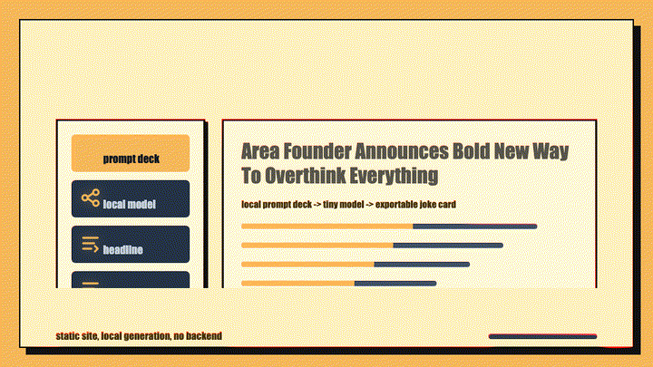

# The Corbin Falls Gazette

<p align="center">
  
</p>

A privacy-first, static daily newspaper about a fictional Neckass: one deterministic issue per day, a wire feed with optional on-device generation, and share/export tools. No build system, no backend.

**Live at [neckass.com](https://neckass.com)** · No build system. No backend. Open `index.html` and you are running.

## What this project is
- **Static-first**: works from local files or any static host.
- **Generator hybrid**: curated headline catalog + optional tiny local LLM.
- **Share-ready UX**: clipboard copy, social links, and front-page clipping export.
- **State-aware**: navigation/session context is persisted with `localStorage` and URL params.

## Quick start
1. Clone the repository.
2. Open `index.html` in a modern browser.
3. Use **Shuffle** to generate and cycle headlines.

## Requirements
- **Runtime:** any modern browser (no build pipeline required).
- **Optional smoke tests:** [Bun](https://bun.sh) (Playwright is a dev dependency installed via `bun install`).

If tooling blocks `file://` URLs, run:

```bash
python -m http.server 8001 --directory .
```

Then open `http://127.0.0.1:8001/`.

## App pages
- `index.html` — today's front page, with the wire feed beneath it.
- `archive.html` — back issues, derived from the calendar rather than stored.
- `about.html` — the encyclopedia entry for the word, which cites the paper.
- `prompts.html` — the Gazette's filing standards.
- `/feed.xml` — the paper as RSS, derived from the date like everything else.

## How an issue is built
The front page is one issue, composed deterministically from its own date
(`modules/issue.js`): the issue number is days since the first edition on
2024-09-29, and that number seeds the selection of lead, briefs, corrections,
weather, classifieds, and letters from `data/formats.js`. Two readers opening
the site on the same day get the same paper, and any past date renders its own
issue at `/?issue=YYYY-MM-DD` — so the archive costs no storage.

A complete standing issue ships in `index.html` itself, so the paper reads with
JavaScript disabled and crawlers see copy rather than an empty shell.

## Edge functions

The site is static; two Cloudflare Pages Functions add what a static file
cannot:

- `functions/feed.xml.js` — builds the RSS feed for the last 30 issues on
  request. No store and no cron: issues come from the calendar.
- `functions/_middleware.js` — rewrites the front page's title and social-card
  tags to the active issue's lead, so a shared link previews with the headline
  that is actually running. The card image stays static; rendering one per
  issue needs an image encoder in the Worker, which is not worth the weight.

Both compose the lead through `functions/lib/issue.mjs`, which mirrors the
arithmetic in `modules/issue.js`. The Workers runtime forbids evaluating the
browser data files, so the leads are extracted to `functions/lib/leads.mjs` by
`bun run feed:build`. `bun run feed:check` fails if that extract has drifted,
and a smoke test asserts the two runtimes pick the same lead for a spread of
dates.

## Using the app
1. The front page is today's issue. It changes once a day, not per visit.
2. Beneath it, **The wire** files items one at a time — from the catalogue or
   from the on-device generator.
3. Use **Next item** and **Previous** to move through the wire.
4. Copy, share, or export any wire item as a clipping.

## Agentic interface
A lightweight browser-side tool interface is exposed at `window.Neckass.agent` after app initialization, so browser automation and agentic LLM runtimes can call headline actions without clicking UI controls directly.

Available tools:
- `get_state`
- `shuffle`
- `previous`
- `generate`
- `select_headline`
- `list_headlines`

Example:

```js
const state = await window.Neckass.agent.call('get_state');
const next = await window.Neckass.agent.call('shuffle');
```

## Optional smoke tests
An optional Playwright smoke suite validates key flows (shuffle, URL restore,
share links, export controls) without changing the no-build runtime model.

```bash
bun install
bun run test:smoke
```

## Documentation map

### Product & behavior
- `SPECIFICATIONS.md` — canonical UI/UX + accessibility requirements.

### For contributors and maintainers
- `CONTRIBUTING.md` — contribution workflow, quality bar, PR checklist.
- `DEVELOPMENT.md` — architecture map, local validation, change strategy.
- `CHANGELOG.md` — notable project changes (Keep a Changelog style).

### Governance
- `CODE_OF_CONDUCT.md` — collaboration expectations and enforcement.
- `SECURITY.md` — vulnerability reporting and response process.
- `LICENSE` — project license.

### Agent-facing
- `AGENTS.md` — repository-specific instructions for coding agents.


## Deployment
[neckass.com](https://neckass.com) is served by Cloudflare Pages (project `neckass`).

The repository root *is* the deploy artifact: there is no output directory, so
Pages publishes the tree exactly as committed. Pushing to `main` triggers a
production deploy; other branches get preview deployments.

To deploy from a working copy instead of a push:

```bash
bunx wrangler pages deploy . --project-name=neckass --branch=main
```

## Verification

`.github/workflows/ci.yml` runs `bun run lint`, `bun run assets:check` and the
Playwright suite on every push to `main` and every pull request.

Pages runs `bun install --frozen-lockfile && bun run lint` as its build
command, so a lint failure fails the build and nothing is published — the site
keeps serving the last good deployment.

**The smoke tests do not gate the deploy.** Pages builds on push regardless of
what GitHub Actions concluded, and running Playwright inside the Pages build
would mean downloading a browser on every deploy. Two ways to close that gap:

1. Require the `verify` check on `main` with a repository ruleset. Changes to
   `main` then have to arrive by pull request, and a red suite blocks the merge.
2. Turn off automatic production deployments in the Pages dashboard and publish
   from CI with `wrangler pages deploy` after the suite passes. Needs a
   Cloudflare API token stored as a GitHub secret.

### Generated assets

`docs/assets/` is build output, not hand-edited artwork. Every PNG is rendered
from `docs/assets/source.svg` by `bun run assets:generate`, which needs
`rsvg-convert` locally; generation is deterministic, so regenerating an
unchanged source produces byte-identical files.

`bun run assets:check` verifies dimensions, colour type, bit depth and a
minimum byte size per scene, and fails on any PNG that is not a known scene —
that last rule is what stops hand-added files rotting in the directory
unnoticed. Both scripts read their scene list from `scripts/asset-specs.ts`.

### Social preview cards

`og-image.png`, `og-about.png`, `og-archive.png` and `og-prompts.png` live at
the repo root, are 1200x630, and are rendered by `bun run og:generate` from
`scripts/generate-og.ts`. `assets:check` covers them too, so one command checks
every generated image.

They are PNG deliberately. They used to be SVG, which no major platform renders
as a link preview, so shared neckass.com links showed no image at all.

## Contributing
PRs are welcome. Start with `CONTRIBUTING.md`, then use `DEVELOPMENT.md` while implementing.

---

## Ecosystem

More open-source projects from [zz-plant](https://github.com/zz-plant):

- [**Stims**](https://github.com/zz-plant/stims) — Browser music visualizer inspired by MilkDrop
- [**sabnzbd-mcp**](https://github.com/zz-plant/sabnzbd-mcp) — MCP server for SABnzbd (zero deps)
- [**Refract**](https://github.com/refract-org/refract) — Open infrastructure for agent-readable knowledge change
- [**ethotechnics.org**](https://github.com/zz-plant/ethotechnics.org) — Essays on ethical technology
